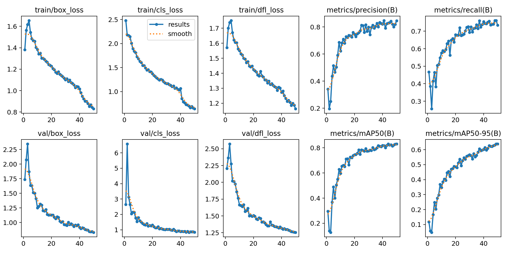

# WatchDog

[](https://github.com/nateramos/WatchDog/actions/workflows/ci.yml)

**Live:** https://main.dbzst24ccqq7g.amplifyapp.com (click **Try the demo** to sign in, no password)

WatchDog is a campus safety tool that informs human responders and does not make decisions for them. It watches a building's security cameras for a possible gun, and when it finds one it sends an alert with a snapshot and a short clip to a reviewer, who confirms the threat or dismisses it as a false alarm. Every decision is signed and logged. It uses no facial recognition. It has been tested on security camera footage from three real school shootings, and it raised no false alarm in an hour of ordinary campus security footage (see [Results](#results)).

Nate Ramos, CUA Busch School AI Vibe Coding Contest, Fall 2026

**Tech stack:** React + Vite, Model Dublin (a YOLO11m model from Ultralytics, trained for guns and knives) running in the browser with ONNX Runtime Web, AWS Amplify Hosting, Amazon Cognito (sign-in), Amazon S3 (demo footage), Vitest and GitHub Actions (tests on every push).

## For judges: try it

1. Open the [live site](https://main.dbzst24ccqq7g.amplifyapp.com) and click **Try the demo**. This signs in a test account with one click; no password, and no real data. Every demo sign-in starts with an empty review log.
2. You land on the **Demo** wall. A step-by-step guide at the top walks you through the rest. Press **Start demo**; about 10 seconds later Camera 1 starts.
3. When Camera 1 turns red, open **Alerts**, press **Play clip** to see what WatchDog saw, type your name in **On duty**, and confirm or dismiss each alert (or press C or D).
4. Open the **Review log** tab to see every decision, who made it and when.

## Why WatchDog was built

**Most attacks are over in minutes.** In the FBI's study of 160 active shooter incidents in the U.S. from 2000 to 2013, 69% of the incidents whose length could be measured ended in five minutes or less, and 60% ended before police arrived ([FBI, 2014](https://www.fbi.gov/file-repository/active-shooter-study-2000-2013-1.pdf)). The study covers all locations; 39 of the 160 were at schools and colleges.

**Schools already have the cameras.** 93% of U.S. public schools used security cameras in 2021–22, up from 61% in 2009–10 ([NCES](https://nces.ed.gov/programs/coe/indicator/a19/school-crime-and-safety/)). What they don't have is someone watching every feed, every second.

Three moments shaped WatchDog:

- **Uvalde, 2022.** 77 minutes passed between the gunman entering Robb Elementary and police stopping him ([U.S. Department of Justice review, 2024](https://abc17news.com/news/national-world/cnn-national/2024/01/18/uvalde-school-massacre-could-have-been-stopped-sooner-doj-report-finds/)).
- **Parkland, 2018.** The school's cameras recorded the shooter, but officers were relying on footage they believed was live while it was being replayed more than 20 minutes behind. The state commission found the confusion "misled officers and deputies" ([WGBH/NPR](https://www.wgbh.org/news/national/2018-11-23/parkland-school-shooting-commission-calls-for-code-red-alarms-and-bleeding-control-kits)).
- **Catholic University, January 2026.** Shots were fired a block from campus during a dispute, and police thought the suspect might have run toward campus. The university sheltered in place for nearly two hours while police searched; no suspect was found on campus ([WTOP](https://wtop.com/dc/2026/01/shelter-in-place-at-catholic-u-in-dc-after-reports-of-shots-fired-near-campus/), [WJLA](https://wjla.com/news/local/catholic-university-assault-brookland-cua-metro-stay-in-place-metropolitan-police-public-safety-officers-northeast-monroe)).

The cameras were there every time. WatchDog watches them so the right person knows within seconds, and that person decides what happens next.

## What's in the app

- **Home page:** a public front page with the problem, how WatchDog works, test results, plans and a cost calculator, and a way into the demo. Everything else is behind sign-in.
- **The console:** after sign-in the app looks like a security control room. A status bar shows the site, whether Model Dublin has loaded, how many alerts are waiting, the reviewer on duty and a live clock; a side rail (a tab bar on phones) links the pages.
- **Demo** (where sign-in lands): a wall of eight cameras replaying a saved WatchDog run. Each tile shows its camera ID and a REPLAY, LIVE or OFFLINE tag like a CCTV feed; offline cameras show NO SIGNAL. The wall can be laid out 2x2, 3x3 or 4x4, and clicking a camera opens it large (Esc goes back). Press **Start demo**: only Camera 1 shows the attacker, in security footage that police released after the 2023 Covenant School shooting in Nashville; it waits about 10 seconds on an empty hallway, then plays once, and a camera with an alert flashes red with a "POSSIBLE GUN · REVIEW" bar. Cameras 2 to 6 show ordinary footage from two public datasets, an indoor school building (MEVA) and outdoor campus walkways (ShanghaiTech Campus), and WatchDog stays quiet on all of them, including a person carrying a broom. Cameras 7 and 8 are offline. The boxes and alerts are WatchDog's real results, saved ahead of time so the demo plays instantly; each alert fires at the moment the video reaches it, and the cameras keep running while you are on other pages. Camera names and locations are a sample building layout, not the real places'. A guide above the wall takes first-time visitors through the demo step by step (start it, watch Camera 1, open the alert, confirm or dismiss, check the Review log) and moves on by itself as they go; it can be hidden and shown again. It was added after user testing, where a first-time visitor thought the demo was already running and missed Start demo.
- **Cameras:** the same wall for live cameras, with search and a **Filters** menu (live or offline, area, floor, wing). No live camera is connected in this prototype, so every slot shows NO SIGNAL.
- **Alerts:** an incident queue. Alerts are listed newest first with a colour for their status (needs review, threat confirmed, false alarm); the selected one opens large with its snapshot and, a few seconds later, a clip from one second before the gun was first seen to four seconds after, which the reviewer plays with **Play clip** and can pause and scrub frame by frame. The reviewer types their name in **On duty**, and every **Confirm threat** or **Dismiss** is signed with it. Keyboard shortcuts: C to confirm, D to dismiss, the arrow keys to move through the queue. The **Review log** tab records every alert and decision ("possible gun", "threat confirmed", "false alarm") and exports them as CSV.

How WatchDog decides what to flag:

1. It checks about four frames per second for a possible gun. The model also knows knives, but WatchDog flags firearms only.
2. A gun counts only at 40% confidence or higher and only if it is found in two checked frames in a row, so one-frame blips are dropped.
3. Detections taller than a quarter of the frame are ignored (see [CCTV size limit](#cctv-size-limit)).
4. A new alert is raised the first time a gun is seen; sightings less than 1.5 seconds apart belong to the same alert, which keeps its clearest frame.
5. Nothing counts as a threat until a person confirms it.

## Safety and privacy

- **Prototype notice:** every page says WatchDog is a prototype and does not replace calling 911.
- **A person decides:** WatchDog never treats a detection as a threat on its own. A reviewer confirms or dismisses every alert, and each decision is signed with their name.
- **Review log:** every alert, its confidence score, the decision, the reviewer and the time are recorded and can be exported.
- **Careful wording:** the app always says "possible gun", and alerts from the Demo page are tagged "Demo replay" so they are never mistaken for live ones.
- **No facial recognition:** WatchDog detects objects only and identifies no one.
- **Video is checked on the device:** the model runs in the viewer's browser, so no video is sent to a server to be analyzed.
- **Real footage, handled with care:** footage of an attack comes only from video that police and news outlets released publicly, and the Demo page shows it on one camera, once. Everyday footage comes from public research datasets (MEVA, filmed with consenting actors, and ShanghaiTech Campus). Sources are credited, no footage is kept in this repo, the Demo page warns before showing the attack, and its camera names are labeled as a sample layout rather than the real places'.
- **Staged clips, never on campus:** home test clips use an orange-tipped prop gun and were filmed at home, not on campus.

## Questions people ask

**What happens when WatchDog gets it wrong?** If it misses a gun, that camera simply raises no alert, which is why WatchDog is an extra set of eyes, not a replacement for staff, procedures or 911. If it raises a false alarm, a reviewer sees the snapshot and clip and clicks Dismiss; nothing is sent anywhere, and the mistake is logged so it can be studied. A real case shows why this matters: in October 2025 another school's AI system flagged a student's bag of chips as a gun after hours, and police arrived with weapons drawn even though school security had already cancelled the alert ([CBS Baltimore](https://www.cbsnews.com/baltimore/news/ai-gun-detection-system-kenwood-high-school-mistakes-a-bag-of-chips)). In WatchDog, nothing leaves the reviewer's screen until a person decides.

**Does it recognize faces?** No. It looks for guns, not people, and identifies no one.

**Does video leave the school?** In the planned product, no: the model runs on a computer inside the building. In this prototype it runs in the viewer's own browser.

**Does it call 911?** No. A person reviews the alert and the school follows its own emergency procedures.

**Who is responsible if it misses something?** The school's staff and procedures stay in charge. WatchDog is sold as an assistive tool, not a guarantee; a real company would say so in its contracts and carry liability insurance.

## Results

WatchDog was tested four ways: on 11,694 labeled images the model never trained on, on security footage from three real school shootings, on an hour of ordinary campus security footage with no guns, and on staged clips filmed at home. None of the test footage was used to train the model.

### Lab test: 11,694 images it never saw

After training, Model Dublin was scored on 11,694 held-out images, kept aside so the model never learned from them, and checked for false alarms on 5,495 look-alike photos with no weapon (phones, umbrellas, remotes and similar).

| Result on the held-out images | |
| --- | --- |
| Gun detection score (mAP50) | **0.874** |
| Look-alike photos correctly ignored | **5,484 of 5,495 (99.8%)** |

mAP50 is the standard accuracy score for object detectors, from 0 to 1 (1.0 would be perfect): it combines finding every gun with being right when it says "gun." Scores like this can't be compared directly with other gun detectors, because each study tests on its own set of images, some easy (clear photos) and some very hard (blurry CCTV).

### Real CCTV from three school shootings

We ran WatchDog on five clips of security camera footage from three real school shootings, released publicly by police and news outlets: Uvalde (Robb Elementary, 2022), Parkland (Marjory Stoneman Douglas High School, 2018) and Nashville (Covenant School, 2023). They cover three very different cameras: a fisheye ceiling camera, a stairwell and a smoke-filled hallway, and ordinary ceiling CCTV. Same settings as the app (Model Dublin, 40% confidence, four checks per second, two in a row, CCTV size limit), run with `tracking/eval_clips.py`.

| Clip | Camera | Alerts | Highest confidence | Checked frames flagged |
| --- | --- | --- | --- | --- |
| Uvalde, 15 s | Fisheye ceiling camera, hallway | 2 | 66% | 5 of 60 |
| Parkland, 27 s | Stairwell, then a smoke-filled hallway | 2 | 82% | 12 of 109 |
| Nashville 1, 19 s | Ceiling camera, hallway | 2 | 77% | 27 of 77 |
| Nashville 2, 10 s | Ceiling camera, hallway | 1 | 84% | 20 of 40 |
| Nashville 3, 7 s | Ceiling camera, lobby | 1 | 76% | 22 of 28 |

**WatchDog raised an alert on all five clips, and all 8 alerts were on the real gun** (we checked every alert snapshot by hand). It did best on ordinary ceiling cameras like Nashville's, where it saw the gun in most checked frames; it struggled most with Uvalde's fisheye lens and a distant figure, where it caught the rifle in moments rather than the whole time. That is enough to point a reviewer at the camera, which is WatchDog's job; following the gun continuously is on the [roadmap](#roadmap).

The footage is not in this repo. The clips were cut from [KVUE's Uvalde hallway video](https://www.youtube.com/watch?v=I3poHE3nOb8), [a Parkland video on YouTube](https://www.youtube.com/watch?v=YM-vc6JqzhM) and [The Washington Post's Nashville video](https://www.washingtonpost.com/video/national/police-release-video-of-nashville-shooter-inside-school/2023/03/28/134b2cd2-de2d-43a1-a312-73ea108c3e7f_video.html), and the Demo page's Nashville feed is served from a separate storage bucket that can be taken down at any time, like its everyday feeds.

### One hour of ordinary campus CCTV: false alarms

A school will ask how often WatchDog raises a false alarm on an ordinary day. We ran it on one hour of everyday security camera footage with no guns: 115 clips (63.4 minutes) from all 13 cameras of the public [ShanghaiTech Campus](https://svip-lab.github.io/dataset/campus_dataset.html) dataset, which shows students walking, carrying backpacks, bags and phones across outdoor walkways and plazas, some of them crowded and close to the camera. Same settings as the app, run on a cloud GPU with `tracking/eval_clips.py`'s check.

| Ordinary campus CCTV, no guns | |
| --- | --- |
| Footage | 63.4 minutes, 115 clips, 13 cameras |
| Frames checked | 12,670 |
| Frames flagged | **0** |
| False alarms (alerts) | **0 in one hour** |

To make sure the detector was really working in that run, we ran two of the Nashville clips through the same setup: it caught the gun with the same results as the table above (84% and 76%). Zero false alarms in one hour does not mean WatchDog never makes one, which is why a person reviews every alert. This footage is outdoors; an indoor hallway test is on the [roadmap](#roadmap). The footage is not in this repo.

### Staged home clips

We also filmed 42 clips at home with an orange-tipped prop gun, which let us control lighting and camera angle to imitate campus CCTV: 6 with the prop gun, and 36 with everyday objects that could fool a detector (a phone, backpack, laptop, game controller, scissors, keys and more), each in normal and dim light. The clips are listed in `tracking/eval/clips.csv`; the videos are not in the repo.

| | Normal light | Dim light | Total |
| --- | --- | --- | --- |
| **Gun clips caught** | 3 of 3 | 3 of 3 | **6 of 6 (100%)** |
| **No-gun clips with no false alarm** | 18 of 18 | 17 of 18 | **35 of 36 (97.2%)** |

Every gun clip was flagged at 76 to 86% confidence, and 1,381 of 1,383 checked frames in the no-gun clips (99.9%) raised no false alarm. Per-clip results are in `tracking/eval/results.csv`; rerun them with `python tracking/eval_clips.py CLIP_DIR`.

## CCTV size limit

Model Dublin is trained to detect guns in any footage. WatchDog adds limits to optimize it for CCTV: on a ceiling camera a whole person fills a small part of the frame, so a real gun is always small. Any detection taller than a quarter of the frame is ignored (`MAX_BOX_HEIGHT` in `src/boxes.js`).

In early testing, dark doorways in dim light caused most false alarms. The CCTV size limit fixed this.

## Speed

In the web demo the model runs on the viewer's own computer, so speed depends on that device (about 1.9 seconds per frame on a 2020 MacBook Air).

**One computer handles about 20 cameras.** On a cloud GPU (NVIDIA T4), Model Dublin takes 24.6 ms per check, about 41 checks a second (measured 15 November 2026 with ONNX Runtime, no extra optimization). A deployed WatchDog checks each camera twice a second, which still sees a gun within half a second of it appearing, so one GPU covers about 20 cameras. The demo checks more often (four times a second, plus a turned view for upright guns), which costs about four times as much computing. NVIDIA's TensorRT and checking only when something moves would raise the camera count further; we haven't measured that yet.

No detector is perfect, which is why a person reviews every flag.

## Business model

**Who it's for:** every kind of school: K-12 districts, private schools, and colleges and their campus police. The people using it are the school's own security staff.

**Plans** (prototype pricing):

| | Price |
| --- | --- |
| Base fee, per school | $200 a month |
| School Day (class hours on school days) | $20 per camera a month |
| Extended (adds evenings, games and events) | $25 per camera a month |
| Always On (around the clock, for colleges and districts) | $30 per camera a month |
| On-site computer | $2,500 each, about one per 20 cameras, set up for free |
| Founding schools | The first five schools pay 50% for their first year, in return for honest feedback |

**What the fees pay for:** the computer is the hardware (a desktop with a gaming-class NVIDIA graphics card costs about $850–1,000 ([PC Gamer](https://pcgamer.com/hardware/gaming-pcs/for-just-under-dollar860-you-can-have-this-little-rtx-4060-gaming-pc-to-get-into-one-of-the-best-hobbies-in-the-world))) plus shipping, setup and staff training. The base fee covers support, health checks on the computer, the dashboard, phone alerts and model updates. The per-camera fee scales with how much the school watches.

| Example (School Day) | Setup | Every year | Founding first year |
| --- | --- | --- | --- |
| 10 cameras (small private school) | $2,500 | $4,800 | $2,400 |
| 40 cameras | $5,000 | $12,000 | $6,000 |

**How it's installed:** we ship the computer ready to go, the school's IT staff plug it into the camera network, and we finish setup remotely. For harder sites we work with the company that installed the school's cameras.

**Billing:** once a year at the start of the school year, or quarterly, paid in advance. We help schools apply for state and federal school-safety grants, which often pay for systems like this.

**Every month** each school gets a short report: alerts raised, how fast staff reviewed them, false alarms dismissed, and whether the computer stayed online.

**Why not the cloud:** a cloud GPU (one T4) costs about $0.53 an hour, about $384 a month, which at about 20 cameras per GPU is about $19 per camera a month in computing alone, almost the whole School Day price. It would also send school video off-site. An on-site computer is a one-time cost and keeps video in the building.

**Growth:** start with schools near Washington, D.C., then partner with the companies that already sell cameras to schools, so WatchDog can come built into the systems schools buy.

**Licensing note:** some training datasets allow research or non-commercial use only (see [Training data](#training-data)); a commercial version would retrain without them.

### How WatchDog compares

| | WatchDog | ZeroEyes | Omnilert |
| --- | --- | --- | --- |
| Price | $20–30 per camera a month, plus $200 a month per school | "Typically costs less than $60 per camera each month" ([KCRG, 2025](https://www.kcrg.com/2025/10/29/cedar-rapids-school-implements-ai-gun-detection-software/)); public contracts about $14–49 ([StateScoop records via NewsBreak](https://www.newsbreak.com/lehigh-daily-349556326/4947359870785-allentown-charter-school-adds-zeroeyes-ai-gun-detection-to-campus-cameras)) | "$500 per camera stream per year" ([EdWeek, 2025](https://www.edweek.org/technology/ai-in-school-security-a-new-tool-with-big-questions/2025/08)) |
| Example contract | 40 cameras: $12,000 a year + $5,000 setup | A two-school Iowa district: $22,500 a year for up to 38 cameras + $5,000 setup | Baltimore County schools: about $2.66 million for about 7,000 cameras, including monitoring ([Center Maryland](https://centermaryland.org/2023/baltimore-county-schools-adds-2-66m-technology-purporting-to-detect-guns-using-ai-to-7000-cameras)) |
| Who reviews alerts | The school's own staff | ZeroEyes' 24/7 operations center, analysts "many with law enforcement and military backgrounds" ([ZeroEyes](https://zeroeyes.com/operations-center)) | Software, with a paid monitoring service available |
| Where the model runs | A computer inside the school | Not compared | Not compared |

ZeroEyes and Omnilert are established products with years of real deployments and far more training data; WatchDog is a student prototype. Its case is price, privacy (video stays in the building) and keeping the school's own people in charge. Prices come from news reports and public contracts, since neither company publishes a price list.

## Rubric alignment

Fall 2026 judging rubric (100 points, plus up to 5 bonus):

| Category | Weight | How WatchDog addresses it |
| --- | --- | --- |
| Functionality & technical execution | 25% | Live on AWS Amplify behind a working Cognito sign-in with a one-click judge account. A camera wall with search and filters, a Demo page replaying real CCTV, an Alerts inbox with a snapshot, a scrubbable clip and signed confirm/dismiss, and an exportable review log. Model Dublin runs in the browser with ONNX Runtime Web. |
| Problem identification & relevance | 20% | Campus safety: most active shooter incidents end within five minutes (FBI) and 93% of public schools already have cameras (NCES), but no one can watch every feed. WatchDog points a person at the moment a camera may show a gun ([Why WatchDog was built](#why-watchdog-was-built)). Tested on security footage from three real school shootings (an alert on all five clips, all on the real gun) and on 42 staged clips with dim light and everyday look-alike objects. |
| AI integration & innovation | 20% | Model Dublin (YOLO11m) trained for 50 epochs on about 146,000 weapon images and 49,000 look-alike photos; a second check on a rotated frame for upright guns; a two-in-a-row rule; a CCTV size limit; alerts raised at the first sighting and upgraded as clearer frames arrive; detection boxes interpolated between checked frames. |
| Code quality & GitHub transparency | 15% | Small single-purpose modules, 40 unit tests, CI on every push, and a step-by-step public commit history. Training data sources, licenses, the training chart and test results are in the repo; real footage is kept out of it. |
| UX & design | 10% | A security-console layout: a status bar with the site, model status, alerts waiting, the reviewer on duty and a live clock; CCTV-style camera tiles with camera IDs, REPLAY/LIVE/OFFLINE tags, NO SIGNAL screens and a flashing red alert bar; 2x2, 3x3 and 4x4 walls and a single-camera view; an incident queue with keyboard shortcuts and signed decisions; a step-by-step demo guide added after watching first-time visitors use the app; a public home page; and layouts checked at phone width (a bottom tab bar on phones). |
| Business impact & presentation | 10% | A priced plan for every kind of school ($200 a month per school plus $20–30 per camera, $2,500 per on-site computer), a cost calculator on the home page, about half what a public contract for a similar system costs, and a sourced comparison with ZeroEyes and Omnilert ([Business model](#business-model)). |
| Bonus: ethical AI | up to 5 | A person confirms every alert and signs each decision, everything is logged, "possible gun" wording and "Demo replay" tags, no facial recognition, video never sent to a server, attack footage only from public police and news releases and everyday footage only from public research datasets, all credited and kept out of the repo. |

## Roadmap

Not built yet:

- Connecting live cameras (the camera wall and the frame-by-frame check are ready; the prototype plays recorded clips)
- Running the model off the page's main thread, so checking a live feed never freezes the page
- A campus map that shows which camera raised an alert
- Following a person or gun across cameras, and predicting where they are heading, for responders
- A one-click incident report (snapshots, clips and decisions) for police and administrators
- A longer false-alarm test on indoor school footage (hallways, cafeteria, gym)

## Run it locally

```
npm install
npm run dev     # local site at http://localhost:5173
npm test        # unit tests
```

Sign-in needs the `amplify_outputs.json` file an Amplify deploy writes; without it the local site shows a notice instead of the login. The Demo page's footage only loads on the live site and at `http://localhost:5199` (`npm run build && npx vite preview --port 5199`).

## Model Dublin

WatchDog's detector is **Model Dublin**, a YOLO11m model (Ultralytics) trained to find guns and knives. It runs at 640 x 640 pixels and is exported to ONNX (`public/models/weapons.onnx`, 80 MB) so it runs in the browser. The model knows both classes, but WatchDog flags firearms only.

How it was trained:

1. **Weapon photos:** about 146,000 public images with a box drawn around each gun or knife, merged from the datasets below. Several of them are real CCTV or surveillance footage.
2. **Look-alike photos:** about 49,000 photos with no weapon (phones, umbrellas, remotes, cameras, ceiling fans and similar), which teach the model what *isn't* a gun.
3. **Training:** 50 epochs (full passes over the training images) on a rented cloud GPU, checked against 11,694 held-out images the model never trained on. We stopped at 50 because further gains would have been too small to notice in practice and not worth more rented GPU time.

Its score on the held-out images is in [Results](#lab-test-11694-images-it-never-saw): 0.874 mAP50 for guns, with 99.8% of look-alike photos correctly ignored.



Model Dublin's training run, one point per epoch. The first three charts in each row are losses (how wrong the model is): the top row on the training images, the bottom row on the held-out images. The last two columns are scores on the held-out images (precision, recall and mAP). The losses fall steadily and the scores rise, and the held-out losses fall along with the training losses, which means the model learned to find guns in new images instead of memorizing the ones it trained on.

### Training data

| Source | What it adds | License |
| --- | --- | --- |
| [Weapons 130k](https://www.kaggle.com/datasets/haiderkhan6410/weapons-130k) (Kaggle) | Guns, knives and background images | CC BY 4.0 |
| Roboflow Universe: FYP Weapon Detection in CCTV, CCTV Gun Detector, Monash Guns Dataset, Detectando Armas, MGD | Guns, several from CCTV | CC BY 4.0 |
| Roboflow Universe: WeaponDataset, NoGun | CCTV guns and gun-free CCTV frames | Research use only |
| [University of Seville, Real-time gun detection in CCTV](https://huggingface.co/datasets/jsalazar/US-Real-time-gun-detection-in-CCTV-An-open-problem-dataset) | Real CCTV of a staged attack, plus synthetic images | CC BY-NC 4.0 |
| [University of Granada, OD-WeaponDetection](https://github.com/ari-dasci/OD-WeaponDetection) | Pistols, knives and similar handheld objects | CC BY 4.0 |
| [Google Open Images V7](https://storage.googleapis.com/openimages/web/index.html) | Guns, knives and look-alike photos | CC BY 4.0 (labels), CC BY 2.0 (images) |
| [YouTube-GDD](https://github.com/UCAS-GYX/YouTube-GDD) | About 5,000 frames from YouTube videos with guns | Apache-2.0 |
| [COCO 2017](https://cocodataset.org/) | Look-alike photos (phones, umbrellas, remotes...) | CC BY 4.0 |

Some sets allow research or non-commercial use only, which fits a student prototype. A commercial version would need to retrain without them. The scripts that built the model are in `tracking/train/` ([how Model Dublin was made](tracking/train/README.md)).

### Test and demo footage

None of this footage was used to train the model, and none of it is in this repo.

| Source | Used for | License |
| --- | --- | --- |
| KVUE (Uvalde), YouTube (Parkland), The Washington Post (Nashville) | Real CCTV test; Demo camera 1 (Nashville) | Publicly released by police and news outlets; used for testing and a credited demo |
| [ShanghaiTech Campus](https://svip-lab.github.io/dataset/campus_dataset.html) (Liu et al., CVPR 2018) | One-hour false-alarm test; Demo cameras 5 and 6 | BSD 2-Clause |
| [MEVA](https://mevadata.org/) (Kitware and IARPA), filmed with consenting actors | Demo cameras 2 to 4 (school hallway, cafeteria, gym) | CC BY 4.0 |

`tracking/track.py` is the desktop prototype: it tracks people (pose) and the objects they hold on a webcam or video file. The web demo is where weapon detection runs.

